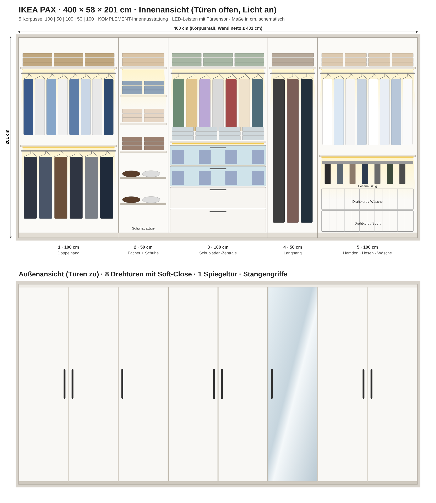

# IKEA PAX: Planung 400 × 58 × 201 cm mit Innenbeleuchtung

## 1. Aktion (mydealz-Deal)
- **10 € Rabatt je 100 € Einkaufswert** bei PAX und KOMPLEMENT, inklusive integrierter Beleuchtung, Griffen und Knöpfen.
- Nur für **IKEA Family** oder IKEA Business Network (die Mitgliedschaft ist kostenlos).
- Der Mindestwert muss **in einem einzigen Einkauf** erreicht werden. Also alles zusammen bestellen.
- Laufzeit laut IKEA **30.10. bis 30.11.2026**. Giga nennt dagegen den **26.11.2026**. Sicherheitshalber **bis zum 25.11.** kaufen.

## 2. Aufteilung: 100 | 50 | 100 | 50 | 100 = 400 cm
Bewährte Faustregeln aus Planungs-Tipps: Selten genutzte Sachen kommen nach oben, Schubladen auf Hüfthöhe, Langhang an den Rand. Doppelhang ergibt etwa die doppelte Hängefläche für Hemden und Hosen.

| # | Korpus | Inhalt |
|---|--------|--------|
| 1 | 100 cm | Hutboden, **Doppelhang** (2 Stangen: oben Hemden/Blusen, unten Hosen/Röcke) |
| 2 | 50 cm  | 4 Fachböden für Pullis/T-Shirts, **2 ausziehbare Schuhregale** |
| 3 | 100 cm | Boden, Kurzhang (Jacken), Boden, **4 Schubladen** (2 davon mit Glasfront) |
| 4 | 50 cm  | Boden, **Langhang** für Mäntel und Kleider; davor die **Spiegeltür** |
| 5 | 100 cm | Boden, Hemdenstange, Boden, **Hosenauszug**, 2 **Drahtkörbe** (Wäsche/Sport) |

Licht: Unter jedem oberen Boden (und unter den Zwischenböden in #1, #3 und #5) sitzt eine LED-Leiste mit Sensor. Sie geht beim Öffnen der Tür automatisch an.

## 3. Einkaufsliste (ca.-Preise DE; vor dem Kauf im PAX-Planer prüfen)
| Menge | Artikel | ca. €/Stk | ca. € |
|---|---|---|---|
| 3 | PAX Korpus 100×58×201 weiß | 80 | 240 |
| 2 | PAX Korpus 50×58×201 weiß | 65 | 130 |
| 7 | Drehtür 50×195 (z. B. FORSAND weiß; edler: BERGSBO/REINSVOLL) | 30 | 210 |
| 1 | Spiegeltür 50×195 (z. B. ÅHEIM) | 90 | 90 |
| 8 | KOMPLEMENT Scharniere mit Soft-Close (Satz je Tür) | 12 | 96 |
| 8 | Stangengriffe (z. B. BAGGANÄS/ORRNÄS, schwarz) | 5 | 40 |
| 4 | KOMPLEMENT Kleiderstange 100 | 8 | 32 |
| 1 | KOMPLEMENT Kleiderstange 50 | 6 | 6 |
| 6 | KOMPLEMENT Boden 100×58 | 15 | 90 |
| 5 | KOMPLEMENT Boden 50×58 | 10 | 50 |
| 2 | KOMPLEMENT Schublade 100×58 | 30 | 60 |
| 2 | KOMPLEMENT Schublade mit Glasfront 100×58 | 40 | 80 |
| 2 | KOMPLEMENT Schuhregal ausziehbar 50×58 | 25 | 50 |
| 1 | KOMPLEMENT Hosenaufhängung ausziehbar 100×58 | 30 | 30 |
| 2 | KOMPLEMENT Drahtkorb ausziehbar 100×58 (+ Schiene) | 25 | 50 |
| 6 | LED-Schrankleiste mit Sensor, 100 cm (z. B. ÖVERSIDAN/SKYDRAG) | 35 | 210 |
| 2 | LED-Schrankleiste mit Sensor, 50 cm | 25 | 50 |
| 2 | TRÅDFRI LED-Treiber + Verbindungskabel | 25 | 50 |
| 1 | Wandbefestigung, Kabelkanal, Einsätze (KOMPLEMENT Einsatz/Box) | – | 60 |
| | **Summe ca.** | | **≈ 1.624 €** |
| | **Aktion: −10 € je volle 100 €** | | **≈ −160 €** |
| | **Endpreis ca.** | | **≈ 1.464 €** |

Spar-Variante: alle Türen FORSAND, ohne Glasschubladen, LED nur unter den oberen Böden (5 Leisten). Dann landest du bei ca. 1.250 € vor Rabatt.
Premium-Variante: Fronten in BERGSBO oder Rahmentüren mit Glas. Dann rechne mit ca. 1.900 bis 2.100 € vor Rabatt.

## 4. Wichtig vor dem Kauf
1. **Wand netto messen**, oben, mittig und unten, ohne Fußleiste. 5 Korpusse brauchen **mindestens ca. 401 cm**.
   Ist die Wand knapp unter 400 cm: Lass einen 50er weg (**100|50|100|100 = 350 cm**). Den Rest füllst du mit einer Blende/Abdeckplatte oder einem offenen Regal.
2. **Raumhöhe ≥ ca. 205 cm**: Der 201er-Korpus wird liegend montiert und dann aufgestellt.
3. **Türen schlagen 50 cm auf**: Davor muss ausreichend Platz sein (Bett!). Sonst sind Schiebetüren die Alternative (die gibt es aber nur für 150/200-cm-Breiten).
4. Pro Korpus eine **Steckdose** in der Nähe oder einen Treiber für mehrere Leisten einplanen. Die Kabel laufen hinter der Rückwand.
5. Den Schrank **unbedingt an der Wand verschrauben** (Kippschutz).

## Quellen
- mydealz: https://www.mydealz.de/deals/ikea-10eur-je-100eur-einkaufswert-bei-pax-und-komplement-2861431
- Giga (Aktion bis 26.11.): https://www.giga.de/tech/wer-bei-ikea-einkauft-bekommt-aktuell-10-euro-pro-100-euro-einkaufswert-rabatt--01M65W195QG82FM9YCX92QV625
- Sparbote: https://www.sparbote.de/72614/ikea-pax-komplement/
- IKEA PAX Korpus 100×58×201: https://www.ikea.com/de/de/p/pax-korpus-kleiderschrank-weiss-70458203/
- IKEA Innenraum-Tipps: https://www.ikea.com/de/de/rooms/bedroom/how-to/so-kannst-du-den-innenraum-deines-pax-kleiderschranks-organisieren-und-verschoenern-pub215e6880/
